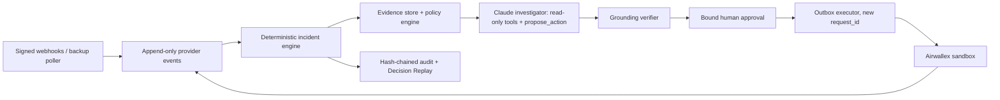

# Quantum Sentinel

*The AI Financial Operations Employee for Global Businesses.*

Quantum Sentinel is an entry in the Airwallex Agentic Banking Hackathon 2026 (Kit 3: Payment Ops Incident Commander). It investigates stuck or failed supplier payments on the **Airwallex sandbox** and recommends **WAIT**, **REPLACE** or **ESCALATE**. It changes its recommendation when new evidence arrives. Deterministic code and a bound human approval stand between the AI and any money movement, so the same obligation can never be paid twice.

## Quick start (one command, no keys)

```bash
docker compose up --build
```

Then open http://localhost:4000. Sign-in tokens for an owner, operator, approver and viewer are written to `.local/demo-tokens.json` on first start; they are git-ignored and never logged. Sign in with the operator token, open **Scenario Lab** and start Scenario A. Without keys, everything runs in clearly labelled MOCK mode: Sentinel simulates Airwallex and uses a rule-based "Mock AI", and nothing leaves your machine.

| | |
| --- | --- |
|  |  |
|  |  |

*Screenshots are captured by the end-to-end tests (`pnpm test:e2e`) in MOCK mode.*

**Status: T3b operator console.** Built and tested with a MOCK Airwallex, a MOCK AI and a real local Postgres:
- the safety core: duplicate-payment fence, incident state machine, bound approvals, executor, audit chain and ledger;
- the Claude investigator: read-only tools, `propose_action`, grounding verifier;
- the HTTP API with roles;
- the web console: Incident Workspace, Decision Replay, Approval Center, Scenario Lab and Audit log.

All three scenarios run end to end in the console in MOCK mode. **Nothing has run against the Airwallex sandbox or the live Claude API yet: the sandbox and Anthropic API keys are pending.** This project has not created any transfer, beneficiary, deposit or other sandbox resource. All funds, suppliers, emails and demo outcomes are **sandbox or simulated**, and the product will label them that way.

Start here:

- [AGENTS.md](AGENTS.md): the Master Build Directive. Identical to [CLAUDE.md](CLAUDE.md).
- [docs/PROGRESS.md](docs/PROGRESS.md): the current tier, what is done, and the next steps.
- [docs/hackathon/OFFICIAL_REQUIREMENTS.md](docs/hackathon/OFFICIAL_REQUIREMENTS.md): verified rules, discrepancies and unknowns.
- [docs/PLAN.md](docs/PLAN.md): architecture, state machines, policy invariants and the backlog.
- [docs/SETUP.md](docs/SETUP.md): sandbox account, MCP and secrets.
- [PRIOR_WORK.md](PRIOR_WORK.md): what was built during the hackathon and what came before.

## Setup

You need Node 24+, pnpm 12 (`npm i -g pnpm@12.15.0`) and Docker. From the repository root:

```bash
pnpm install && pnpm check
```

`pnpm check` runs lint, typecheck, the unit tests, and the integration tests. The integration tests start Sentinel's own Postgres with Docker Compose on `127.0.0.1:54329`. They never use port 5432.

`pnpm test:e2e` runs the browser tests. It uses your installed Google Chrome, with its own throwaway database and API on `:4100`.

### Run the console for development (hot reload)

1. Create a git-ignored `.env` from the template (PowerShell command below). Run `pnpm seed:demo` once. It prints a `SENTINEL_ORGANIZATION_ID` line; add it to `.env`.
2. Run `pnpm seed:demo` again. It creates an owner, an operator, an approver and a viewer, and prints each sign-in token once.
3. Start the database and API with `pnpm db:up` and `pnpm api` (`:4000`). In another terminal, start the console with `pnpm web` (`:5173`).
4. Open http://localhost:5173, sign in with the operator token, then go to **Scenario Lab** and start Scenario A.

Without Airwallex keys, the Lab runs in MOCK mode: Sentinel simulates the provider and nothing leaves the machine. Without an Anthropic key, the investigator is the labelled **Mock AI**. Both are shown in the top bar on every screen. Set `APPROVAL_HMAC_SECRET` in `.env` so approvals survive an API restart.

### Sandbox and live AI

To talk to the sandbox, create a git-ignored `.env` from the template. In PowerShell:

```powershell
if (-not (Test-Path -LiteralPath .env)) { Copy-Item -LiteralPath .env.example -Destination .env }
```

Fill it in by following [SETUP.md](docs/SETUP.md). Keep keys out of chat, screenshots and Git. Then you can run:

| Command | What it does |
| --- | --- |
| `pnpm sandbox check` | Read-only: login, balances, global accounts. Saves redacted fixtures |
| `pnpm sandbox seed-org` | Creates the demo tenant row |
| `pnpm sandbox fund --amount 60000` | Makes sure a USD global account exists, then runs a **simulated** deposit |
| `pnpm sandbox beneficiary` | Creates the synthetic supplier (US / USD / ACH) |
| `pnpm sandbox transfer --beneficiary <id> --amount 25000` | Creates a transfer with a fresh `request_id` |
| `pnpm sandbox transition --id <id> --to FAILED --failure-type BENEFICIARY_BANK_RETURNED` | **Simulated** status change |
| `pnpm sandbox watch --id <id>` | Polls quickly and prints every status change with timing |
| `pnpm sandbox history --id <id>` | Shows what Sentinel knows and its finality classification |
| `pnpm api` | Operator API, webhook receiver, backup poller and executor worker on `:4000` |
| `pnpm web` | Operator console on `:5173` (proxies `/api` to `:4000`) |
| `pnpm seed:demo` | Creates the demo tenant and one sign-in token per role |
| `pnpm up` | `docker compose up --build`: Postgres + API + console on `:4000` |
| `pnpm test:e2e` | Playwright browser tests against an isolated stack |
| `pnpm attacks` | Runs the 33-attack adversarial suite and writes [docs/ATTACKS.md](docs/ATTACKS.md); exits 1 if any attack succeeds |
| `pnpm audit:verify` | Recomputes the audit hash chain; exits 1 if anything was altered |
| `pnpm reconcile` | Checks ledger and provider-transfer invariants; reports, never repairs |
| `pnpm investigate <incidentId>` | Runs one live Claude investigation (spends API credits; needs Anthropic credentials) |

## Architecture (planned)



## Safety boundary

`PAID` does not prove the money finally arrived, because Airwallex documents failures that happen after PAID. Sentinel keeps three things separate: the provider status, the failure evidence it has recorded, and its own judgement of finality. An unknown outcome keeps the payment lock in place. See the [official transfer lifecycle](https://www.airwallex.com/docs/payouts/transfers/create-a-transfer/transfer-statuses).

## Deliverables

| Deliverable | Current result |
| --- | --- |
| Scenario A (WAIT → REPLACE → RESOLVED) | Runs end to end in the console and the API tests (MOCK provider, Mock AI, real Postgres); not yet run on the sandbox |
| Scenarios B (races) and C (fraud / reconciliation) | Run in the console and API tests (MOCK): B race gives 1 approval and 1 transfer; C escalates and blocks payment. Reconciliation mismatch is covered in DB tests (SYNTHETIC) |
| Vitest / fast-check | 147 unit and 61 Postgres integration tests passing (`pnpm check`) |
| Browser tests (Playwright) | 11 passing (`pnpm test:e2e`): sign-in, loading/error/empty states, Scenarios A, B, C, roles, Decision Replay, audit, no sideways scroll at 375px |
| AI investigator | Passing with a scripted MOCK model (honest, hallucinating, policy-overriding, prompt-injected); not yet run against the live API |
| Playwright | Not implemented |
| Attack scoreboard | [33 attacks run, 0 succeeded](docs/ATTACKS.md) (`pnpm attacks`; MOCK provider, scripted / Mock AI models, real Postgres and API) |
| EVAL.md | Not run yet; no results claimed |
| TLC model check | Not run; no proof claimed |
| Demo video (< 5 min) | Planned for T5 |
