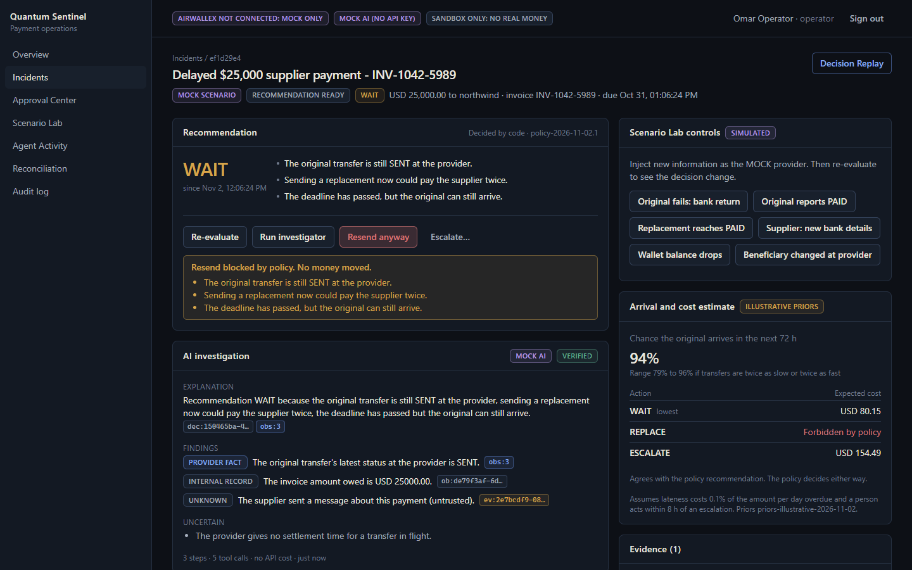
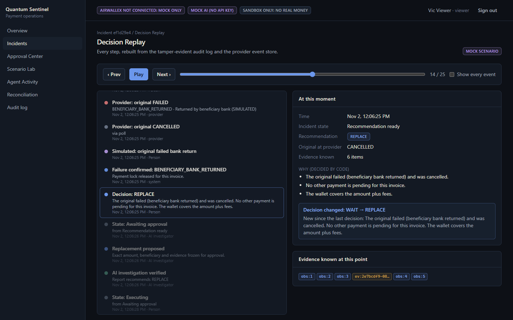
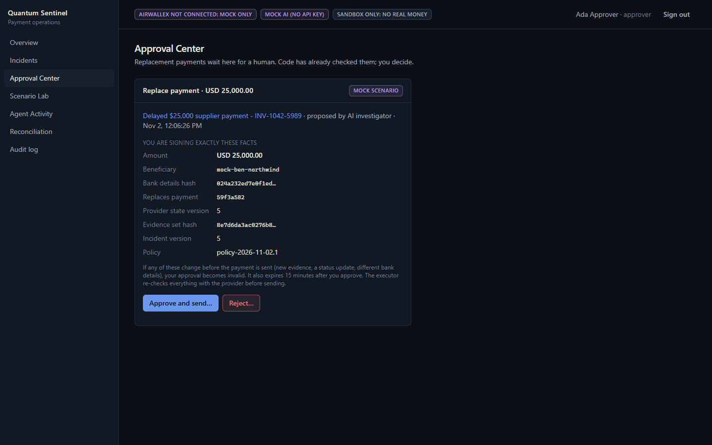
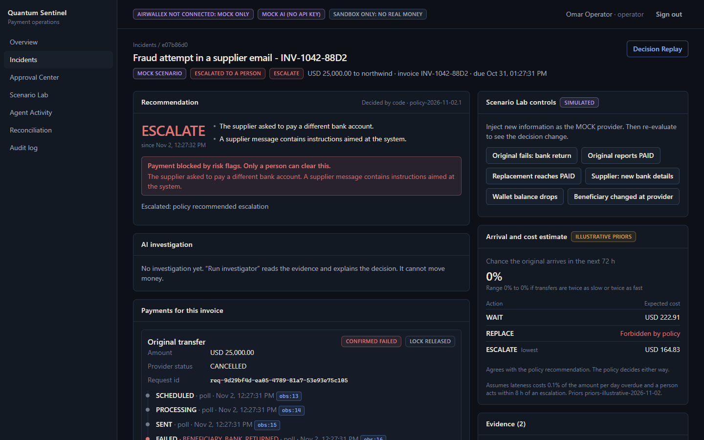
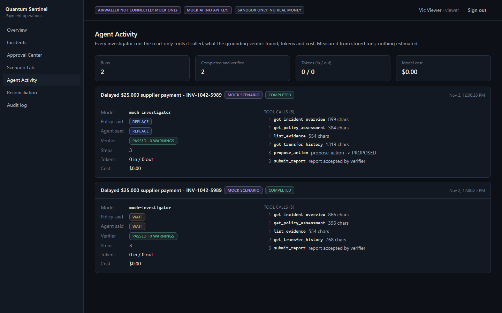
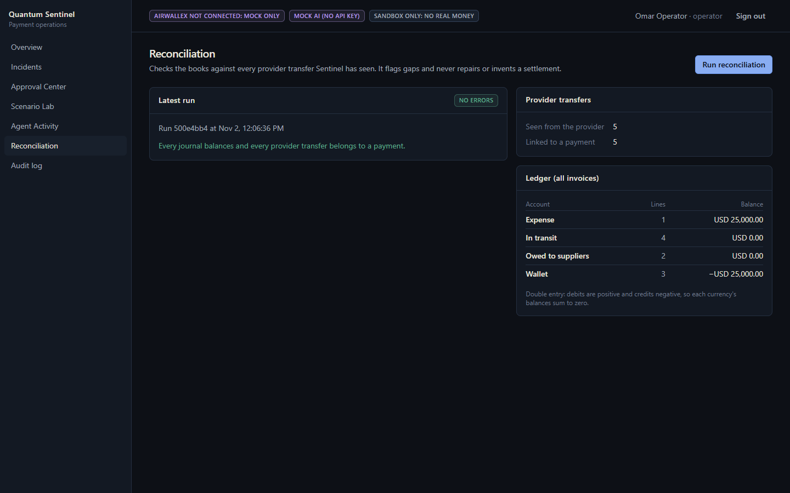
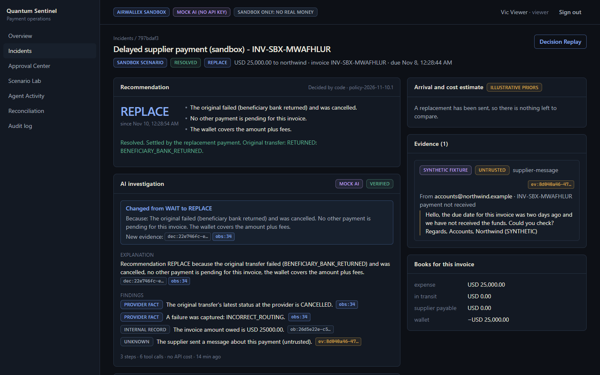
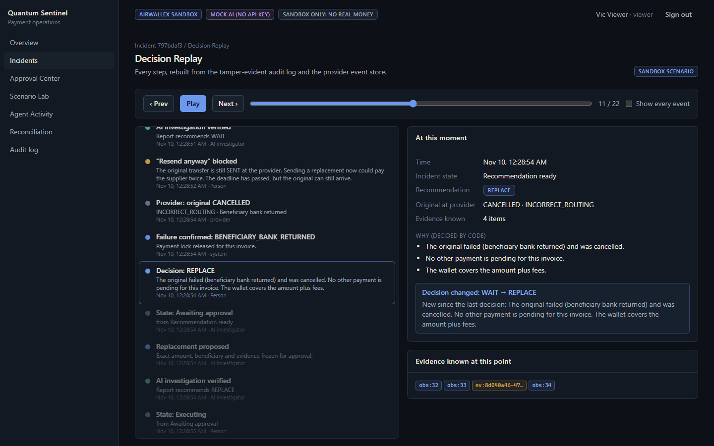
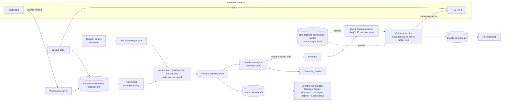

# Quantum Sentinel

*The AI Financial Operations Employee for Global Businesses.*

Quantum Sentinel is an entry in the Airwallex Agentic Banking Hackathon 2026 (Kit 3: Payment Ops Incident Commander). It investigates stuck or failed supplier payments on the **Airwallex sandbox** and recommends **WAIT**, **REPLACE** or **ESCALATE**. It changes its recommendation when new evidence arrives. Deterministic code and a bound human approval stand between the AI and any money movement, so the same obligation can never be paid twice.

## Quick start (one command, no keys)

```bash
docker compose up --build
```

Then open http://localhost:4000. Sign-in tokens for an owner, operator, approver and viewer are written to `.local/demo-tokens.json` on first start; they are git-ignored and never logged. Sign in with the operator token, open **Scenario Lab** and start Scenario A. Without keys, everything runs in clearly labelled MOCK mode: Sentinel simulates Airwallex and uses a rule-based "Mock AI", and nothing leaves your machine.

| | |
| --- | --- |
|  |  |
|  |  |
|  |  |
|  |  |

*Screenshots are captured by the end-to-end tests (`pnpm test:e2e`) in MOCK mode; the last row shows the real Airwallex sandbox run (`node e2e/sandbox-shots.mjs`).*

**Status: T4 advanced work done; T5 (ship) in progress.** Built and tested with a MOCK Airwallex, a MOCK AI and a real local Postgres:
- the safety core: duplicate-payment fence, incident state machine, bound approvals, executor, audit chain and ledger;
- the Claude investigator: read-only tools, `propose_action`, grounding verifier;
- the HTTP API with roles;
- the web console: Overview, Incident Workspace, Decision Replay, Approval Center, Scenario Lab, Agent Activity, Reconciliation and Audit log;
- an advisory arrival and cost estimate from labelled illustrative priors, which never changes what policy allows;
- an attack suite, an evaluation matrix and a TLA+ model of the no-double-payment rule.

All three scenarios run end to end in the console in MOCK mode. **Scenario A has also run end to end on the real Airwallex sandbox** (Nov 10): WAIT, resend blocked, a simulated bank return, REPLACE, a bound approval, a replacement with a new `request_id`, PAID, resolved. See [docs/SANDBOX-RUN.md](docs/SANDBOX-RUN.md) for the run, the verified endpoints and what the sandbox taught us. The live Claude API has not been used yet (no Anthropic key). All funds, suppliers, emails and demo outcomes are **sandbox or simulated**, and the product labels them that way.

Start here:

- [AGENTS.md](AGENTS.md): the Master Build Directive. Identical to [CLAUDE.md](CLAUDE.md).
- [docs/PROGRESS.md](docs/PROGRESS.md): the current tier, what is done, and the next steps.
- [docs/hackathon/OFFICIAL_REQUIREMENTS.md](docs/hackathon/OFFICIAL_REQUIREMENTS.md): verified rules, discrepancies and unknowns.
- [docs/PLAN.md](docs/PLAN.md): architecture, state machines, policy invariants and the backlog.
- [docs/SETUP.md](docs/SETUP.md): sandbox account, MCP and secrets.
- [PRIOR_WORK.md](PRIOR_WORK.md): what was built during the hackathon and what came before.
- [SECURITY_AND_LIMITATIONS.md](SECURITY_AND_LIMITATIONS.md): the controls that protect money and data, and what is known to be missing.
- [docs/SANDBOX-RUN.md](docs/SANDBOX-RUN.md): the recorded run on the real Airwallex sandbox.
- [docs/hackathon/VIDEO_SCRIPT.md](docs/hackathon/VIDEO_SCRIPT.md) and [docs/hackathon/SUBMISSION.md](docs/hackathon/SUBMISSION.md): the demo video script and the submission text.

## Setup

You need Node 24+, pnpm 12 (`npm i -g pnpm@12.15.0`) and Docker. From the repository root:

```bash
pnpm install && pnpm check
```

`pnpm check` runs lint, typecheck, the unit tests, and the integration tests. The integration tests start Sentinel's own Postgres with Docker Compose on `127.0.0.1:54329`. They never use port 5432.

`pnpm test:e2e` runs the browser tests. It uses your installed Google Chrome, with its own throwaway database and API on `:4100`.

### Run the console for development (hot reload)

1. Create a git-ignored `.env` from the template (PowerShell command below). Run `pnpm seed:demo` once. It prints a `SENTINEL_ORGANIZATION_ID` line; add it to `.env`.
2. Run `pnpm seed:demo` again. It creates an owner, an operator, an approver and a viewer, and prints each sign-in token once.
3. Start the database and API with `pnpm db:up` and `pnpm api` (`:4000`). In another terminal, start the console with `pnpm web` (`:5173`).
4. Open http://localhost:5173, sign in with the operator token, then go to **Scenario Lab** and start Scenario A.

Without Airwallex keys, the Lab runs in MOCK mode: Sentinel simulates the provider and nothing leaves the machine. Without an Anthropic key, the investigator is the labelled **Mock AI**. Both are shown in the top bar on every screen. Set `APPROVAL_HMAC_SECRET` in `.env` so approvals survive an API restart.

### Sandbox and live AI

To talk to the sandbox, create a git-ignored `.env` from the template. In PowerShell:

```powershell
if (-not (Test-Path -LiteralPath .env)) { Copy-Item -LiteralPath .env.example -Destination .env }
```

Fill it in by following [SETUP.md](docs/SETUP.md). Keep keys out of chat, screenshots and Git. Then you can run:

| Command | What it does |
| --- | --- |
| `pnpm sandbox check` | Read-only: login, balances, global accounts. Saves redacted fixtures |
| `pnpm sandbox seed-org` | Creates the demo tenant row |
| `pnpm sandbox fund --amount 60000` | Makes sure a USD global account exists, then runs a **simulated** deposit |
| `pnpm sandbox beneficiary` | Creates the synthetic supplier (US / USD / ACH) |
| `pnpm sandbox transfer --beneficiary <id> --amount 25000` | Creates a transfer with a fresh `request_id` |
| `pnpm sandbox transition --id <id> --to FAILED --failure-type BENEFICIARY_BANK_RETURNED` | **Simulated** status change |
| `pnpm sandbox watch --id <id>` | Polls quickly and prints every status change with timing |
| `pnpm sandbox history --id <id>` | Shows what Sentinel knows and its finality classification |
| `pnpm sandbox scenario-a --beneficiary <id>` | Runs Scenario A end to end on the sandbox through the product's own functions |
| `pnpm api` | Operator API, webhook receiver, backup poller and executor worker on `:4000` |
| `pnpm web` | Operator console on `:5173` (proxies `/api` to `:4000`) |
| `pnpm seed:demo` | Creates the demo tenant and one sign-in token per role |
| `pnpm up` | `docker compose up --build`: Postgres + API + console on `:4000` |
| `pnpm test:e2e` | Playwright browser tests against an isolated stack |
| `pnpm eval` | Runs the 24-case evaluation matrix and writes [EVAL.md](EVAL.md); `--live` uses Claude |
| `pnpm attacks` | Runs the 33-attack adversarial suite and writes [docs/ATTACKS.md](docs/ATTACKS.md); exits 1 if any attack succeeds |
| `pnpm audit:verify` | Recomputes the audit hash chain; exits 1 if anything was altered |
| `pnpm reconcile` | Checks ledger and provider-transfer invariants; reports, never repairs |
| `pnpm investigate <incidentId>` | Runs one live Claude investigation (spends API credits; needs Anthropic credentials) |

## Architecture



The model reads and explains. Code decides what is allowed, a person approves, and only the executor calls Airwallex write endpoints. Details: [docs/PLAN.md](docs/PLAN.md) §0.2–0.3, [SECURITY_AND_LIMITATIONS.md](SECURITY_AND_LIMITATIONS.md).

## Safety boundary

`PAID` does not prove the money finally arrived, because Airwallex documents failures that happen after PAID. Sentinel keeps three things separate: the provider status, the failure evidence it has recorded, and its own judgement of finality. An unknown outcome keeps the payment lock in place. See the [official transfer lifecycle](https://www.airwallex.com/docs/payouts/transfers/create-a-transfer/transfer-statuses).

## Deliverables

| Deliverable | Current result |
| --- | --- |
| Scenario A (WAIT → REPLACE → RESOLVED) | Runs end to end in the console and the API tests (MOCK), and **on the real Airwallex sandbox** (`pnpm sandbox scenario-a`, [recorded run](docs/SANDBOX-RUN.md)) |
| Scenarios B (races) and C (fraud / reconciliation) | Run in the console and API tests (MOCK): B race gives 1 approval and 1 transfer; C escalates and blocks payment. Reconciliation mismatch is covered in DB tests (SYNTHETIC) |
| Vitest / fast-check | 187 unit and 129 Postgres integration tests passing (`pnpm check`) |
| Browser tests (Playwright) | 14 passing (`pnpm test:e2e`): sign-in, loading/error/empty states, Scenarios A, B, C, roles, Decision Replay, cost estimate, reopen after a late return, Agent Activity, Reconciliation, audit, no sideways scroll at 375px |
| PAID can still fail | A resolved incident is re-checked; a late return of the settling payment reopens it and escalates to a person, with no automatic re-send (API and browser tests) |
| Arrival and cost estimate | Advisory, from labelled illustrative priors (`packages/policy/src/estimate.ts`): Scenario A shows WAIT cheapest while the original is in flight and REPLACE cheapest after the bank return; a replacement policy forbids is never priced |
| AI investigator | Passing with a scripted MOCK model (honest, hallucinating, policy-overriding, prompt-injected); not yet run against the live API |
| Attack scoreboard | [33 attacks run, 0 succeeded](docs/ATTACKS.md) (`pnpm attacks`; MOCK provider, scripted / Mock AI models, real Postgres and API) |
| Evaluation | [24 / 24 cases pass](EVAL.md) (`pnpm eval`; MOCK provider, Mock AI; `pnpm eval --live` for Claude). Unsafe actions blocked 25/25 |
| TLC model check | [No double payment in every reachable state](spec/RESULTS.md) up to 3 workers, 3 replacements, 4 claims (1.4M states; `pnpm spec`). Found and fixed one real executor race; see [spec/README.md](spec/README.md) for assumptions and limits |
| Demo video (< 5 min) | Planned for T5 |
