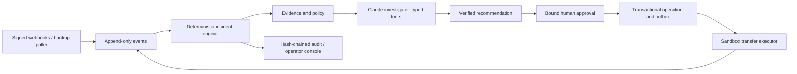

# Quantum Chartered — Payment Ops Incident Commander

An Airwallex sandbox hackathon project to investigate delayed supplier transfers, recommend **WAIT**, **REPLACE**, or **ESCALATE**, and put deterministic safety checks and human approval before a replacement.

**Status: Phase 0 planning only. There is no runnable application yet.** No transfers, beneficiaries, deposits, or other financial resources have been created by this project. All planned funds, suppliers, emails, and demo outcomes are synthetic or sandbox simulated.

Read [the implementation plan](docs/PLAN.md), [current progress](docs/PROGRESS.md), [sandbox/MCP setup](docs/SETUP.md), and [prior-work disclosure](PRIOR_WORK.md). The user-provided rules are preserved identically in [AGENTS.md](AGENTS.md) and [CLAUDE.md](CLAUDE.md).

## Setup today

From the repository root in PowerShell:

```powershell
if (-not (Test-Path -LiteralPath .env)) { Copy-Item -LiteralPath .env.example -Destination .env }
```

This creates an ignored credentials file without replacing one that already exists. Follow [SETUP.md](docs/SETUP.md) for the sandbox account and MCP authentication. Phase 0 needs no API keys. Keep keys out of chat, screenshots, and Git.

The target launch command is `docker compose up --build`, to be implemented and tested in Phase 1. There is currently no Compose file or test runner; claiming that command works now would be inaccurate.

## Planned architecture



## Safety boundary

`PAID` does not prove final recipient arrival; Airwallex documents late failures. The design therefore distinguishes provider status, recorded failure evidence, and application finality. Unknown outcomes retain the payment lock. The selected initial scope uses USD local transfers and escalation for late failures after `PAID`. See the [official transfer lifecycle](https://www.airwallex.com/docs/payouts/transfers/create-a-transfer/transfer-statuses) and [PLAN.md](docs/PLAN.md) for the proof assumptions.

## Planned submission

Working sandbox demo, repository with one-command setup, and a video under five minutes. Dates supplied by the team: build October 27–November 13, 2026; finalists November 15; remote-capable Demo Day November 19. These dates have not been independently confirmed with the event organizer.

| Deliverable | Current result |
| --- | --- |
| Three end-to-end scenarios | Not implemented or run |
| Vitest / fast-check | Not implemented or run |
| Adversarial scoreboard | Not run; no success count claimed |
| TLC model checking | Not run; no proof claimed |
| Demo GIF, EVAL.md, video script | Planned for shipping phase |
