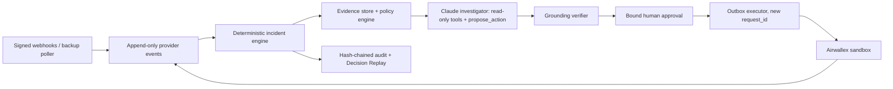

# Quantum Sentinel

*The AI Financial Operations Employee for Global Businesses.*

Quantum Sentinel is an entry in the Airwallex Agentic Banking Hackathon 2026 (Kit 3: Payment Ops Incident Commander). It investigates stuck or failed supplier payments on the **Airwallex sandbox** and recommends **WAIT**, **REPLACE** or **ESCALATE**. It changes its recommendation when new evidence arrives. Deterministic code and a bound human approval stand between the AI and any money movement, so the same obligation can never be paid twice.

**Status: T0 feasibility, documentation only. There is no runnable application yet.** This project has not created any transfer, beneficiary, deposit or other sandbox resource. All funds, suppliers, emails and demo outcomes are **sandbox or simulated**, and the product will label them that way.

Start here:

- [AGENTS.md](AGENTS.md): the Master Build Directive. Identical to [CLAUDE.md](CLAUDE.md).
- [docs/PROGRESS.md](docs/PROGRESS.md): the current tier, what is done, and the next steps.
- [docs/hackathon/OFFICIAL_REQUIREMENTS.md](docs/hackathon/OFFICIAL_REQUIREMENTS.md): verified rules, discrepancies and unknowns.
- [docs/PLAN.md](docs/PLAN.md): architecture, state machines, policy invariants and the backlog.
- [docs/SETUP.md](docs/SETUP.md): sandbox account, MCP and secrets.
- [PRIOR_WORK.md](PRIOR_WORK.md): what was built during the hackathon and what came before.

## Setup today

From the repository root in PowerShell:

```powershell
if (-not (Test-Path -LiteralPath .env)) { Copy-Item -LiteralPath .env.example -Destination .env }
```

This creates a git-ignored credentials file and never overwrites an existing one. Fill it in by following [SETUP.md](docs/SETUP.md). Keep keys out of chat, screenshots and Git.

The target launch command is `docker compose up --build`. It arrives in T1 and does not exist yet.

## Architecture (planned)



## Safety boundary

`PAID` does not prove the money finally arrived, because Airwallex documents failures that happen after PAID. Sentinel keeps three things separate: the provider status, the failure evidence it has recorded, and its own judgement of finality. An unknown outcome keeps the payment lock in place. See the [official transfer lifecycle](https://www.airwallex.com/docs/payouts/transfers/create-a-transfer/transfer-statuses).

## Deliverables

| Deliverable | Current result |
| --- | --- |
| Scenario A (WAIT → REPLACE → RESOLVED) on the real sandbox | Not implemented |
| Scenarios B (races) and C (fraud / reconciliation) | Not implemented |
| Vitest / fast-check / Playwright | Not implemented or run |
| Attack scoreboard, EVAL.md | Not run; no results claimed |
| TLC model check | Not run; no proof claimed |
| Demo video (< 5 min) | Planned for T5 |
