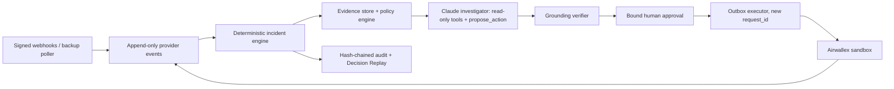

# Quantum Sentinel

*The AI Financial Operations Employee for Global Businesses.*

Quantum Sentinel is an entry in the Airwallex Agentic Banking Hackathon 2026 (Kit 3: Payment Ops Incident Commander). It investigates stuck or failed supplier payments on the **Airwallex sandbox** and recommends **WAIT**, **REPLACE** or **ESCALATE**. It changes its recommendation when new evidence arrives. Deterministic code and a bound human approval stand between the AI and any money movement, so the same obligation can never be paid twice.

**Status: T3a investigator.** The safety core (duplicate-payment fence, incident state machine, bound approvals, executor, audit chain, ledger) and the Claude investigator (read-only tools, `propose_action`, grounding verifier) are built and tested with a MOCK Airwallex, a MOCK model and a real local Postgres. **Nothing has run against the Airwallex sandbox or the live Claude API yet: the sandbox and Anthropic API keys are pending.** This project has not created any transfer, beneficiary, deposit or other sandbox resource. All funds, suppliers, emails and demo outcomes are **sandbox or simulated**, and the product will label them that way.

Start here:

- [AGENTS.md](AGENTS.md): the Master Build Directive. Identical to [CLAUDE.md](CLAUDE.md).
- [docs/PROGRESS.md](docs/PROGRESS.md): the current tier, what is done, and the next steps.
- [docs/hackathon/OFFICIAL_REQUIREMENTS.md](docs/hackathon/OFFICIAL_REQUIREMENTS.md): verified rules, discrepancies and unknowns.
- [docs/PLAN.md](docs/PLAN.md): architecture, state machines, policy invariants and the backlog.
- [docs/SETUP.md](docs/SETUP.md): sandbox account, MCP and secrets.
- [PRIOR_WORK.md](PRIOR_WORK.md): what was built during the hackathon and what came before.

## Setup

You need Node 24+, pnpm 12 (`npm i -g pnpm@12.15.0`) and Docker. From the repository root:

```bash
pnpm install && pnpm check
```

`pnpm check` runs lint, typecheck, the unit tests, and the integration tests. The integration tests start Sentinel's own Postgres with Docker Compose on `127.0.0.1:54329`. They never use port 5432.

To talk to the sandbox, create a git-ignored `.env` from the template. In PowerShell:

```powershell
if (-not (Test-Path -LiteralPath .env)) { Copy-Item -LiteralPath .env.example -Destination .env }
```

Fill it in by following [SETUP.md](docs/SETUP.md). Keep keys out of chat, screenshots and Git. Then you can run:

| Command | What it does |
| --- | --- |
| `pnpm sandbox check` | Read-only: login, balances, global accounts. Saves redacted fixtures |
| `pnpm sandbox seed-org` | Creates the demo tenant row |
| `pnpm sandbox fund --amount 60000` | Makes sure a USD global account exists, then runs a **simulated** deposit |
| `pnpm sandbox beneficiary` | Creates the synthetic supplier (US / USD / ACH) |
| `pnpm sandbox transfer --beneficiary <id> --amount 25000` | Creates a transfer with a fresh `request_id` |
| `pnpm sandbox transition --id <id> --to FAILED --failure-type BENEFICIARY_BANK_RETURNED` | **Simulated** status change |
| `pnpm sandbox watch --id <id>` | Polls quickly and prints every status change with timing |
| `pnpm sandbox history --id <id>` | Shows what Sentinel knows and its finality classification |
| `pnpm api` | Webhook receiver on `:4000` plus the backup poller |
| `pnpm audit:verify` | Recomputes the audit hash chain; exits 1 if anything was altered |
| `pnpm reconcile` | Checks ledger and provider-transfer invariants; reports, never repairs |
| `pnpm investigate <incidentId>` | Runs one live Claude investigation (spends API credits; needs Anthropic credentials) |

A single `docker compose up` that also runs the API and the web console arrives once those apps exist.

## Architecture (planned)



## Safety boundary

`PAID` does not prove the money finally arrived, because Airwallex documents failures that happen after PAID. Sentinel keeps three things separate: the provider status, the failure evidence it has recorded, and its own judgement of finality. An unknown outcome keeps the payment lock in place. See the [official transfer lifecycle](https://www.airwallex.com/docs/payouts/transfers/create-a-transfer/transfer-statuses).

## Deliverables

| Deliverable | Current result |
| --- | --- |
| Scenario A (WAIT → REPLACE → RESOLVED) | Passing against a MOCK provider and real Postgres; not yet run on the sandbox |
| Scenarios B (races) and C (fraud / reconciliation) | Safety layer passing (MOCK provider); agent and UI not built |
| Vitest / fast-check | 147 unit and 49 Postgres integration tests passing (`pnpm check`) |
| AI investigator | Passing with a scripted MOCK model (honest, hallucinating, policy-overriding, prompt-injected); not yet run against the live API |
| Playwright | Not implemented |
| Attack scoreboard, EVAL.md | Not run; no results claimed |
| TLC model check | Not run; no proof claimed |
| Demo video (< 5 min) | Planned for T5 |
