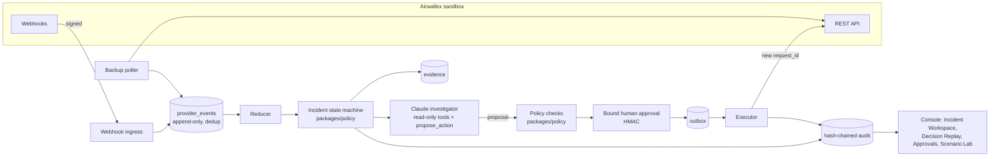
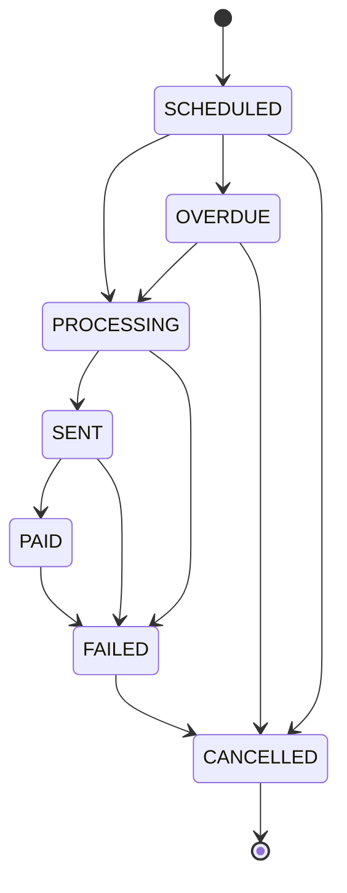

# Quantum Sentinel — plan (Kit 3: Payment Ops Incident Commander)

Prepared October 27, 2026. Codex wrote §1–§12 for the original brief. Claude Code added §0 the same day, after the founder issued the Master Build Directive (`AGENTS.md`). **§0 takes precedence where the two differ.** §1–§12 remain the detailed design.

## 0. Quantum Sentinel alignment (Master Build Directive)

### 0.1 What changed from the original brief

- Product name **Quantum Sentinel**. Work is organized in **tiers T0–T5** (AGENTS.md §11), replacing "Phases 0–4" in §10. The mapping is: Phase 1 → T1; Phase 2 → T2 + T3a + T3b; Phase 3 → T4; Phase 4 → T5.
- Multi-tenant from the start: `organization_id` on every table and in every repository function, with roles Owner / Approver / Operator / Viewer.
- The agent's only write tool is **`propose_action`**, replacing §8's `propose_replacement`. It covers REPLACE as well as a proposed ESCALATE or WAIT acknowledgement.
- Every evidence item carries one of the labels *provider fact / internal record / synthetic fixture / AI interpretation / unknown*.
- **Decision Replay** is a must-have flagship screen, no longer an advanced extra.
- Ledger and reconciliation (double-entry `ledger_entries`, `reconciliation_runs`) are in T2.
- The UI style is now dark charcoal and navy, replacing the original off-white/black.

### 0.2 Repository layout (target, created in T1)

```text
apps/api            Fastify v5: operator API, webhook ingress, and a second process entry `worker`
                    (reducer, backup poller, outbox executor, agent runs). Agent tool loop lives in src/agent.
apps/web            React + Vite + Tailwind + Radix operator console
packages/contracts  Zod schemas shared by api/web: money (bigint minor units), states, report JSON, tool I/O
packages/policy     Pure deterministic code: finality, duplicate, balance and approval rules, incident state
                    machine, approval HMAC canonicalization, audit hash chain. No I/O.
packages/airwallex  Typed sandbox adapter: auth refresh, unit conversion, request_ids, retries, decoders.
                    `simulation/` sub-module is separate and never exposed to the agent.
packages/db         Drizzle schema, SQL migrations (partial unique indexes, checks), transaction helpers
scripts/            fund-wallet, create-beneficiary, create-transfer, transition, audit-verify, replay
spec/               TLA+ model + TLC config (T4)
```

`packages/db` is the one addition to the directive's layout (decision D16). Migrations are shared by api, worker, scripts and integration tests.



### 0.3 Policy invariants and how each is tested

| # | Invariant (AGENTS.md §6) | Enforcement | Test |
|---|---|---|---|
| 1 | At most one blocking or successful payment per obligation | Partial unique index on `payments(obligation_id) WHERE blocking`, plus `SELECT … FOR UPDATE` on the obligation | Real-Postgres test with N parallel replace requests leading to exactly 1 row. fast-check command sequences (webhooks, polls, approvals, retries, crashes) checked against the real reducer |
| 2 | Replace only after a confirmed terminal failure with a recorded type | `policy.canReplace()` requires a `FailureObservation` plus a CANCELLED observation, and the original never PAID | Table test for every provider status. Property test: no random history without a failure observation ever yields `canReplace=true` |
| 3 | Never retry an uncertain payment as a new transfer | Outbox keeps the same `request_id`. UNKNOWN keeps the fence. Reconcile via `GET /transfers?request_id=` | Fake adapter that times out after accepting the request: exactly one provider transfer |
| 4 | Bound, expiring approvals | HMAC over the canonical tuple. 15-minute TTL. Consumed once under lock | Mutate each bound field, then verify fails. Expiry test. Two concurrent consumers: exactly one wins |
| 5 | Revalidate provider state before execution | Executor re-reads the transfer and beneficiary when it claims the outbox job | Status changes between approval and claim: blocked |
| 6 | Amount, currency, beneficiary and balance (including fees) | `policy.checkFunds()` uses bigint arithmetic | Boundary tests (balance = need, need − 1). Property tests on minor-unit arithmetic |
| 7 | Tenant isolation | `organizationId` is a required argument on every repository function. Composite foreign keys include `organization_id` | Cross-tenant read/write attempts all fail |
| 8 | Idempotency on every write, safe under concurrency | Unique `operations.idempotency_key`. API `Idempotency-Key` header on operator POSTs | Double-click and parallel POST tests |
| 9 | Webhooks: signature, dedup, out-of-order, no regressions | Verify before parse. Unique `(org, provider_event_id)`. Append-only failure observations | Tampered body/timestamp, replayed events, reversed order, FAILED followed within ms by a bare CANCELLED |
| 10 | Hash-chained append-only audit with `verify` | `prev_hash`/`hash` over canonical JSON. DB trigger rejects UPDATE/DELETE | Edit, delete or reorder an entry: verify fails at the exact sequence number |
| 11 | Reconciliation never invents settlement | Every provider transfer is matched to a payment or flagged. Ledger sums to zero | Synthetic mismatch produces a flag plus an escalation, and no state change |
| 12 | Fail closed | Any decoder, policy or LLM error leads to HOLD/ESCALATE | Fault injection on each dependency |
| 13 | Supplier text is untrusted; bank-detail changes always escalate | Deterministic detector plus beneficiary hash comparison, independent of the LLM | Prompt-injection corpus: the agent may say anything, but policy still blocks |

### 0.4 Airwallex feasibility check (T0, first thing once keys exist)

Read-only first, then the smallest possible mutations. Every response is saved, redacted, under `fixtures/sandbox/` with its date and the API version.

1. `POST /api/v1/authentication/login`: record the status code (201 vs 200) and the `expires_at` format.
2. Read the account's API version. Pin it with `x-api-version` (candidate `2026-08-21`, which uses the `failure` object shape).
3. `GET` the global accounts list (path to be confirmed in the Docs MCP before calling) and `GET /api/v1/balances/current`. An empty list counts as success.
4. If there is no USD account: `POST /api/v1/global_accounts/create` (`country_code: "US"`, `required_features: [{currency:"USD", transfer_method:"LOCAL"}]`).
5. `POST /api/v1/simulation/deposit/create` for an illustrative amount. Re-read the balance to see whether it is usable immediately.
6. `POST /api/v1/beneficiary_api_schemas/generate` for USD/US/LOCAL, then `POST /api/v1/beneficiaries/create` with synthetic details.
7. `POST /api/v1/transfers/create` (small amount, UUID `request_id`), then transition to PROCESSING → SENT. Read it back.
8. Transition to `FAILED` + `BENEFICIARY_BANK_RETURNED`. Poll quickly to measure **how many seconds pass before CANCELLED**, and record the exact failure fields at each step.
9. A second transfer with a new `request_id` → SENT → PAID. Read it back.
10. Re-send step 7's exact request with the same `request_id`: record the duplicate error envelope and its spelling.

Exit: [API-RESEARCH.md](API-RESEARCH.md) gains a "Verified in sandbox" table. Each row is one endpoint, its observed status code, a fixture path and the date.

### 0.5 Backlog T0–T2

**T0 Feasibility (Oct 27–28)**
- [x] Dedicated repo, git, AGENTS.md/CLAUDE.md, MCP config
- [x] `docs/hackathon/OFFICIAL_REQUIREMENTS.md`
- [x] PLAN.md (this file)
- [ ] Founder: sandbox account, API key in `.env`, Developer MCP login (via `/mcp` in Claude Code)
- [ ] Feasibility run §0.4 steps 1–5 (auth, version, global account, deposit, balance)
- [ ] Verified-endpoint table in API-RESEARCH.md

**T1 Integration proof (Oct 28–30)**
- [ ] pnpm workspace, TS config, Vitest, ESLint, Docker Compose (Postgres) with `pnpm test` green
- [ ] `packages/contracts`: Money (bigint minor units, currency exponent table) and major↔minor conversion, with property tests
- [ ] `packages/airwallex`: sandbox-only base URL guard, token cache with single-flight refresh, typed Zod decoders, endpoint-specific retry policy, `request_id` generation, error normalization. Tested against a fake server
- [ ] `packages/db`: initial migrations (organizations, obligations, payments, provider_events, failure_observations, evidence, operations)
- [ ] Scripts: fund wallet, create beneficiary, create transfer, transition (SENT / PAID / FAILED + type). §0.4 steps 6–10 against the real sandbox
- [ ] Webhook ingress (signature over raw body, dedup, persist before 200) and a cloudflared tunnel
- [ ] Backup poller. Test: "FAILED flips to CANCELLED in seconds" never loses the failure
- [ ] Evidence store with provenance labels

**T2 Safety core (Oct 30–Nov 2)**
- [ ] Incident state machine (pure) and persisted transitions
- [ ] Policy engine invariants 1–13 (table above)
- [ ] Bound approvals (HMAC, TTL, single consumption)
- [ ] Outbox executor with revalidation, reconciliation of unknown outcomes and a replacement `request_id`
- [ ] Hash-chained audit, a DB trigger and `pnpm audit:verify`
- [ ] Double-entry ledger, reconciliation run
- [ ] Concurrency property tests: no double payment

The original first slice (§1: USD LOCAL, no FX) stays. SWIFT and its two EUR 12.85 fees are out of scope unless the founder asks.

## 1. Goal and scope

Investigate one delayed supplier obligation, explain a grounded WAIT / REPLACE / ESCALATE decision, obtain human approval, and execute a replacement only after deterministic safety checks. All funds, accounts, emails, and suppliers are synthetic or Airwallex sandbox resources. Never connect production endpoints or the production AgentOS MCP.

Selected first slice: USD local payments, no FX, one sandbox business, a pre-registered synthetic beneficiary, and one authenticated operator. The user delegated this scope choice ("do what is best"). Use the requested TypeScript / Fastify / PostgreSQL / Drizzle / Zod stack, Claude tool use, React + Vite, Vitest + fast-check, and TLC. Dependencies, model identifier, and tool payloads will be pinned during their implementation phases.

The team supplies these dates: build October 27–November 13, 2026; finalists November 15; Demo Day November 19. Target Phase 1 by October 30, Phase 2 by November 4, advanced work November 5–9, submission preparation November 10–12, buffer November 13. These are planning dates, not independently verified event deadlines.

## 2. Sources and contract corrections

Read the [builder guide](https://airwallexdev.com/guide), [connection instructions](https://airwallexdev.com), and [official API introduction](https://www.airwallex.com/docs/api/introduction). The developer lab itself states that it is not official API documentation. Exact fields come from the API reference and Docs MCP, then sandbox contract checks.

Detailed evidence: [API research](API-RESEARCH.md), [webhook research](WEBHOOK-RESEARCH.md). Registration and verification status: [SETUP.md](SETUP.md).

Important changes from the brief:

- Candidate pin: `x-api-version: 2026-08-21`. Since `2026-06-30`, current transfer responses use `failure.code`, `failure.message`, and `failure.details.type` rather than the legacy top-level failure fields. Simulation still accepts `failure_type`. Keep raw evidence and decode by the observed contract; do not silently mix shapes. [Versioning](https://www.airwallex.com/docs/api/versioning), [changelog](https://www.airwallex.com/docs/api/changelog)
- Current beneficiary schema endpoint is `POST /api/v1/beneficiary_api_schemas/generate`; the guide's `/beneficiaries/schema` is not the current reference path. Beneficiary creation and deposit simulation do not document a `request_id` field. Resolve per-endpoint deduplication without inventing fields. [Beneficiaries](https://www.airwallex.com/docs/api/payouts/beneficiaries), [deposit simulation](https://www.airwallex.com/docs/api/simulation/deposits)
- `PAID` can later fail. `FAILED` auto-cancels within seconds. Webhook `version` denotes API schema version, not event order. These require changes to the naive success/failure model. [Transfer statuses](https://www.airwallex.com/docs/payouts/transfers/create-a-transfer/transfer-statuses), [webhook envelope](https://www.airwallex.com/docs/developer-tools/webhooks/listen-for-webhook-events)

No authenticated sandbox resource calls have been completed. Payload fixtures, scopes, account version, fee behavior, failure timing, and arrival/refund evidence remain unverified against this account. If docs disagree, stop that integration step and ask with the conflicting sources; continue independent work only.

## 3. Provider transfer state machine

Main flow for current API generations, with optional Airwallex approval states kept separate from our app approval:



This diagram summarizes the [documented transfer lifecycle](https://www.airwallex.com/docs/payouts/transfers/create-a-transfer/transfer-statuses), not every rail-specific condition. Optional provider approval states include `IN_APPROVAL`, `APPROVAL_RECALLED`, `APPROVAL_REJECTED`, and `APPROVAL_BLOCKED`. We do not use provider approval workflows for the initial demo. Unknown or legacy states block execution until explicitly mapped.

Store provider status independently from application finality. `FAILED` is failure evidence, not permission to release the duplicate fence immediately. `CANCELLED` alone does not identify the cause. `PAID` supports monitoring, not a claim that the recipient irrevocably received funds.

Sandbox scenario control uses the documented `next_status` and `failure_type`; the initial bank-return path uses `SENT → FAILED` with `BENEFICIARY_BANK_RETURNED`, followed by observed cancellation. Verify the actual transitions before marking this scenario runnable. Simulation commands are operator/dev scripts, never investigator tools. [Simulation reference](https://www.airwallex.com/docs/api/simulation/transfers/api)

## 4. Incident state machine

Main lifecycle: `OPEN → INVESTIGATING → RECOMMENDED → AWAITING_APPROVAL → EXECUTING → MONITORING → RESOLVED / ESCALATED`.

| Transition | Required condition |
| --- | --- |
| OPEN → INVESTIGATING | Obligation identified and linked to original transfer; initial evidence recorded |
| INVESTIGATING → RECOMMENDED | Policy evaluated; structured report validates; every factual claim has supported evidence |
| RECOMMENDED → AWAITING_APPROVAL | Immutable proposal, evidence hash, amount, beneficiary snapshot, and state versions frozen |
| AWAITING_APPROVAL → EXECUTING | REPLACE approved; signature, actor, freshness, finality, balance, limits, and duplicate fence all pass atomically |
| AWAITING_APPROVAL → MONITORING | WAIT acknowledged; schedule next review and deadline without creating a payment |
| AWAITING_APPROVAL → INVESTIGATING | Rejection, expired approval, or new material evidence; old approval permanently invalidated |
| EXECUTING → MONITORING | Provider acceptance reconciled, or dispatch result uncertain; uncertainty keeps fence/reservation and prevents another send |
| MONITORING → INVESTIGATING | New evidence or review deadline; re-evaluate without releasing any payment fence |
| MONITORING → RESOLVED | Original fate recorded; obligation satisfied with arrival evidence under the declared sandbox contract; no unknown dispatch or unresolved contradiction |
| Any nonterminal state → ESCALATED | Fraud signal, changed bank details, unprovable finality, unsupported contract, or unrecoverable execution uncertainty |
| RESOLVED → INVESTIGATING / ESCALATED | Late contradictory event reopens the incident and invalidates prior conclusions; it never automatically permits a new transfer |

Risk flags block payment as soon as they are recorded; an operator cannot approve away a bank-detail swap. An escalation records the reason and assigned operator in the console; no external email is sent by default. ESCALATED may return to INVESTIGATING only through an authenticated manual action with new evidence and a fresh approval cycle.

## 5. The duplicate-payment boundary

The desired invariant is **at most one final, successful recipient payment per obligation**. Provider `PAID` events are not the definition of final settlement. Code can prove its own scheduling and authorization behavior under explicit provider assumptions; it cannot prove how an external bank behaves.

For the initial replacement demo, require all of the following:

1. Original transfer belongs to the same account and immutable supplier obligation; original amount, currency, and beneficiary agree with the obligation.
2. Captured authoritative bank-return failure evidence plus a current `CANCELLED` observation; a bare cancellation, recall request, or timeout is insufficient.
3. The chosen sandbox scenario demonstrates the return/refund and non-arrival assumptions. Record transfer-linked reconciliation evidence. An increase in aggregate wallet balance alone is not proof of this original's refund. If no documented correlation is available, require explicit, visibly simulated fixture evidence for the demo or escalate; do not fabricate provider fields.
4. No known prior `PAID` state for the original in the initial implementation. Late-paid returns are escalated pending a broader finality model. Missing/inconsistent history is uncertainty, not proof that `PAID` never occurred.
5. No risk hold, changed bank data, unconsumed execution, pending/unknown prior dispatch, or satisfied obligation.
6. Fresh available balance covers principal, fees, reserve floor, and other local reservations; a valid bound approval authorizes this exact intent.

Enforcement design:

- Enforce one canonical obligation per `(account, approved supplier identity, normalized invoice reference)` and unique ownership of each `(account, provider transfer ID)`. Imports without a reliable invoice identity require review; they cannot silently create a second payable obligation. These constraints must survive concurrent imports.
- Lock the obligation row in every transition affecting payment eligibility. A partial unique index allows only one blocking payment intent per obligation; pending, unknown, in-flight, and successful intents continue to block successors.
- Confirmed failed intent release and new replacement allocation happen in one transaction. A fulfilled-obligation record remains a permanent fence against another payment. Enforce writes through a narrow DB role and a checked transition function/trigger so direct writes cannot silently clear that fence.
- A unique operation ID / provider request ID binds the exact immutable request payload. Never reuse an ID for a different body; never create a new ID because of a timeout or double click.
- Durable outbox: transactionally consume one approval and persist the intent, reservation, audit entry, and dispatch job. Commit before HTTP. Persist outcome in a new transaction. Never hold a database transaction open across an external request.
- At ingress, advance a relevant-evidence generation under the obligation lock. Dispatch authorization requires its reducer watermark to cover every committed relevant event and invalidates approval if the evidence generation changed. Unmapped account events conservatively block related account dispatch until classified. Test a persisted PAID event with a deliberately delayed reducer. Recheck these gates when claiming the outbox job, not only when clicking Approve.
- Retrieve the authoritative beneficiary immediately before authorization, compare its normalized bank-details hash, and bind the exact validated executable payload. The supplier cannot select a new beneficiary. If the API only accepts a mutable beneficiary ID without a version precondition, document and enforce the demo assumption that no out-of-band editor changes it; unresolved drift blocks execution. A final read alone cannot remove that external race.
- Worker crash, response loss, or duplicate job: reconcile by request ID and retain the fence. A lease prevents concurrent workers; request-ID stability protects retries. After provider deduplication retention expires, an unknown operation requires escalation, not retransmission.
- External changes during dispatch cannot be prevented by our database lock. If a contradiction arrives after dispatch has begun, record it, block all further payments, and escalate. The proof explicitly depends on terminal-failure non-arrival and provider idempotency assumptions.

Provider transfer deduplication is documented as seven days, so permanent application uniqueness is essential. The current docs expose more than one duplicate-error spelling; normalize documented aliases and reconcile the original result rather than treating them as permission to replace. [Transfer API](https://www.airwallex.com/docs/api/payouts/transfers), [error codes](https://www.airwallex.com/docs/payouts/errors/transfer-error-codes)

## 6. Architecture and proposed data model

```text
apps/api          Fastify API, operator authentication, webhook ingress
apps/worker       event reducer, backup poller, outbox dispatcher, investigation jobs
apps/console      React + Vite operator console
packages/domain   money, states, deterministic policy, shared Zod contracts
packages/db       Drizzle schema, migrations, constraints, transaction helpers
packages/airwallex typed version-pinned sandbox boundary
packages/agent    Claude tool schemas, report validation, evidence checks
packages/audit    canonical encoding, approval binding, hash chain verification
spec/             TLA+ model, TLC configuration, assumptions, saved results
scripts/          sandbox preparation, simulation, replay, audit verification
```

**Superseded by §0.2.** The directive's layout is used instead: the worker lives in `apps/api`, agent code in `apps/api/src/agent`, and audit and domain rules in `packages/policy`. Nothing has been scaffolded yet.

| Entity | Essential data and guarantees |
| --- | --- |
| accounts / operators | Explicit sandbox account identity and operator role; every query scoped to that account |
| obligations | Unique account+supplier+normalized invoice identity, positive minor-unit amount, currency, due time, approved beneficiary snapshot/hash, fulfillment fence, aggregate version, ingress/reducer watermarks |
| incidents | Obligation link, lifecycle, policy version, latest report, owner, next review time, resolution evidence |
| transfers / payment_intents | Original/replacement role, predecessor link, unique account+provider ID ownership, stable request ID, payload hash, raw status, normalized failure, finality classification, blocking flag |
| events / webhook_inbox | Immutable event ID, provider ID, account, source, raw body/hash, signature result, API version, occurred_at, received_at, local aggregate version; unique provider event ID within account |
| failure_observations | Transfer, evidence ID, first-seen time, original raw fields and normalized cause; append-only; never erased by a later snapshot |
| evidence | Source, trust class, immutable content/hash, relevant facts, captured time, effective time; email content is untrusted data |
| recommendations | Structured claims and evidence IDs, WAIT/REPLACE/ESCALATE, policy inputs/result, model ID, prompt version, evidence-set hash |
| approvals | Bound intent, actor, nonce, expiry, signature/key version, consumed/invalidated state; single consumption under lock |
| operations / outbox | Unique operation, exact request payload/hash, retry history, UNKNOWN outcome, lease/fencing token, next attempt; all persisted before external mutation |
| wallet_reservations | Currency/account/operation, principal+fee budget, expiry policy that cannot release unknown dispatches; serialize concurrent local spending |
| audit_entries / checkpoints | Per-incident sequence, canonical payload, previous hash, current hash, actor/time, periodic independent checkpoint |

All monetary storage uses PostgreSQL BIGINT and TypeScript bigint; API-facing internal JSON uses validated integer strings. Currency exponents come from an explicit supported-currency table; reject unsupported currencies and fractional minor units. Convert transfer/balance major-unit fields exactly once at the Airwallex boundary with decimal-safe serialization/parsing and range checks. Conversion is field-specific: optional application-fee fields have a different documented unit and are out of scope (see API-RESEARCH.md). Never use floating-point arithmetic for money.

Every durable state change, event append, reservation update, and audit append is a DB transaction. Rebuild projections only from immutable event history, with reducer/policy versions recorded. Retain both observed-at order (what the agent knew) and provider occurrence time; replay cannot retroactively give the agent later evidence.

## 7. Ingress, polling, authentication, and retries

- Verify the webhook HMAC over timestamp plus raw bytes before accepting evidence. Validate signature encoding, compare in constant time, enforce a configurable replay window, and use the configured subscription secret. No JSON parse/re-serialization before verification.
- Durably insert and deduplicate verified events before HTTP 200, then reduce asynchronously. An invalid signature never creates trusted evidence. Known duplicates acknowledge without applying a second transition.
- Assign our own aggregate version under lock. Use provider timestamps as evidence only; a total rank of statuses is invalid because PAID can fail. Equal-time conflicts, stale polls, and unknown events trigger reconciliation or escalation.
- Preserve captured failure facts even when the next observation is CANCELLED without details. A webhook arriving after a poll can enrich history without regressing the reconciled projection. Polling cannot recover every missed transient failure; unresolved gaps stay visible.
- Refresh bearer tokens from returned `expires_at` with a buffer and a single shared refresh; never log keys or tokens. Sandbox base URL is an exact allowlist; reject unsafe redirects and production hosts.
- Classify retries per endpoint: safe reads use bounded exponential backoff/jitter and respect rate limits; keyed mutations reuse the stored body and key; unkeyed mutations get a local operation key and no automatic uncertain replay. Authentication and schema reads must not receive invented idempotency fields.
- Balance reads are preflight checks, not provider reservations. Serialize local currency reservations and still handle provider insufficient-funds responses. Spending outside this app is an external assumption to monitor.

Exact signature/delivery fields and auth/balance references are in [WEBHOOK-RESEARCH.md](WEBHOOK-RESEARCH.md). Phase 1 will test a public HTTPS tunnel exposing only the webhook endpoint.

## 8. Typed tools and approval contract

These are our proposed application tools, not claimed Airwallex endpoint names. All inputs/outputs use Zod; account context comes from the session, never arbitrary model input.

| Tool | Access and result |
| --- | --- |
| get_incident | Read lifecycle, obligation, internal versions, and risk holds |
| get_transfer_evidence | Read original/replacement snapshots and retained failure observations with evidence IDs |
| get_available_balance | Read normalized available cash, freshness, and reservations |
| read_supplier_evidence | Read synthetic email/invoice text explicitly marked untrusted |
| get_policy_assessment | Read deterministic safety gates, deadlines, fees, and expected-cost comparisons |
| get_audit_timeline | Read prior actions and evidence at an internal version |
| propose_replacement | Persist a draft proposal only if deterministic proposal gates pass; returns blocked reasons or proposal ID; cannot send money |
| submit_incident_report | Validate structured WAIT/REPLACE/ESCALATE claims and their citations |

Only authenticated operator endpoints can approve/reject. Only the internal worker can execute an approved replacement. The LLM cannot call simulation, create/change a beneficiary, approve its own proposal, choose credentials, or directly call Airwallex money APIs.

Approval HMAC covers canonical `(account ID, incident ID, obligation ID, action, amount_minor, currency, beneficiary ID, beneficiary-details hash, evidence-set hash, original transfer ID, transfer-state version, incident version, policy version, nonce, expiry, approver ID)`. The minimum required tuple from the brief is included. The server signs after authenticated approval, stores key version, and verifies again at dispatch authorization. Any bound change invalidates approval; consume it once in the execution transaction. Include session protection/CSRF controls where relevant.

Audit entries use canonical serialization and a hash chain with transactionally assigned sequence numbers. Verification detects edits, deletions in the middle, and reordering. A chain alone does not stop privileged rewriting or suffix truncation: pin/export a trusted checkpoint and disclose this limitation. No secrets or full bank details enter the audit log.

## 9. Evidence, economics, and LLM behavior

Model output is a constrained JSON report: recommendation, supported claims with evidence IDs, conflicts, missing evidence, policy explanation, and next review/escalation reason. Render factual sentences from validated claims so every sentence has evidence. Citation presence is not semantic proof: validate known status/amount/identity/time predicates against typed facts; reject unsupported causal claims or mark explicitly as hypothesis. The model cannot override verifier failure.

Supplier email cannot change approved bank data. Deterministic matching and a bank-change risk flag block replacement even if the model follows a malicious instruction. Contradictions preserve both sources and force review. Limit tool iterations, tokens, and wall time; on model/network failure produce a deterministic hold/escalation with evidence.

Expected-cost policy is evaluated only over safety-eligible actions. Use integer monetary costs and fixed-point probabilities: waiting cost from delay/deadline; replacement cost from fees and residual loss/recovery assumptions; escalation cost from review effort/delay. For an ineligible replacement, its cost is effectively forbidden regardless of low estimated arrival probability. Priors by rail/status/elapsed time are illustrative synthetic parameters, visibly labeled. Version these inputs and show sensitivity; no claim of calibrated prediction without real data.

## 10. Phases and acceptance gates

> Superseded by the tier schedule in AGENTS.md §11 and the backlog in §0.5. The acceptance evidence below still applies to the matching tiers.

| Phase | Work | Evidence required before the user approves the next phase |
| --- | --- | --- |
| 0 — plan | Instructions, Git, MCP setup, official research, plan/questions, provenance | Document consistency and secret-ignore checks; accurate MCP status; no app tests claimed |
| 1 — sandbox plumbing | Workspaces, Compose, Postgres migrations, versioned client, auth, money conversion, reconciliation, scripts, signed webhook inbox and poller | Unit tests plus real-Postgres integration tests; authenticated read contract; captured sandbox fixtures; SENT→FAILED→CANCELLED reason-retention test; one-command clean setup |
| 2 — working core | State machine, DB fences/reservations/outbox, bound approvals, basic hash chain, evidence/report checks, Claude investigator, operator console | Three demo paths; concurrent approval/retry/crash tests; zero unauthorized or duplicate sends in core adversarial cases; inspectable audit |
| 3 — advanced | Expand claim verification, attack scoreboard, audit checkpoints, cost model, TLC/fast-check refinement, replay | Measured scenario results; saved seeds/traces; TLC config, state count, assumptions and result; replay equality |
| 4 — ship | README/GIF, EVAL.md (8–10 cases), video <5 min, setup rehearsal, security/idempotency/race/secrets self-review | Fresh-clone Compose run, recorded demo, actual results table, accurate prior-work record, no invented pass counts |

After every phase: run the applicable checks, update PROGRESS.md and decisions, make a small reviewable commit, summarize results, and wait for the user's OK. Move foundational approvals and attack checks into Phase 2; Phase 3 expands them. Defer advanced presentation before weakening core safety.

### Demo and evaluation matrix

| Scenario | Expected result |
| --- | --- |
| Original SENT within window | WAIT; review scheduled, no replacement |
| Captured bank return, reconciled cancellation/refund, sufficient cash | REPLACE proposal; single human approval; replacement PAID plus simulated arrival evidence and recorded original fate → RESOLVED |
| Supplier requests new bank details | ESCALATE; payment blocked |
| Deadline passed but original could still arrive | ESCALATE; cost model cannot bypass finality |
| Terminal failure but insufficient available balance/fee reserve | ESCALATE; no send |
| FAILED immediately becomes bare CANCELLED | Original reason retained; same safe decision as complete history, otherwise escalate |
| Replayed/out-of-order webhooks and stale polls | One effective application per event; no erased failure facts or unsafe regression |
| Double click / concurrent approvals / worker crash after API acceptance | At most one created replacement, stable request ID, unknown outcome reconciled |
| Evidence/amount/beneficiary/state changes during approval | Approval invalidated before dispatch; new review required |
| Prompt injection or late original PAID evidence | Block unauthorized actions; late-payment conflict escalated |

Actual outcomes, time-to-recommendation, and duplicates blocked are **not run** in Phase 0. Attack scoreboard will distinguish attempted violations, blocked attempts, and succeeded violations; report zero only after running the declared suite.

### Meaningful tests and formal model

- Money round trips (including 0/2/3-decimal currencies), invalid precision/overflow, exact request serialization, token refresh races, endpoint-specific retry policy.
- Real PostgreSQL tests for constraints and competing transactions; duplicate invoice/transfer imports; persisted-but-unreduced evidence at dispatch; external beneficiary drift; process crashes on both sides of HTTP; cross-obligation reservation races; seven-day provider-window expiry.
- Signed raw-body fixtures, tampered bytes/timestamps, duplicates, reversed delivery, same-time conflicts, failure retention and API-version incompatibility.
- fast-check command sequences against the real reducer/persistence layer: webhook arrival, poll, approval, rejection, dispatch/retry, crash/restart, evidence mutation. Record shrinkable counterexamples and seeds.
- TLC model in `/spec` includes obligations, original/replacement attempts, approvals, message duplication/reordering/loss, retries, unknown dispatches, and provider deduplication bounds. Invariants cover one blocking intent, valid consumed approval, and at most one final successful recipient payment.
- Model explicit provider assumptions: terminal confirmed failure cannot later settle; retries with the same ID inside retention create one transfer; all app writes use the guarded path; no out-of-band payment for this obligation. Include adversarial traces violating assumptions to show why escalation is necessary. Never label finite-state model checking as an unconditional proof about real banks.

## 11. Risks and unresolved decisions

| Risk / unknown | Planned response |
| --- | --- |
| Finality/refund/arrival evidence not fully specified by docs | Agree the sandbox fixture contract; escalate ambiguous real observations; no broad guarantee |
| API docs / guide / Docs MCP retrieve mixed versions | Explicit pin and versioned fixtures; contract failure blocks writes |
| Unkeyed setup/simulation mutations | Local operation tracking and manual reconciliation after uncertainty; no blind retries |
| Late events and failed webhooks | Persist raw events; poll as backup; preserve gaps and captured reasons |
| New bank instructions / prompt injection | Immutable beneficiary snapshot plus deterministic hold |
| External wallet spending | Fresh available cash, local reservations, provider error handling |
| HMAC key compromise / audit rewrite | Independent secrets and key versions; checkpoints; explicit trust boundary |
| Deadline and scope | Ship three complete paths first, then advanced layers in the specified order |
| MCP access / local tooling | Docs MCP verified; Developer OAuth attempt timed out and needs user login; Claude CLI and Java not found on PATH; Docker engine and Compose verified |

## 12. Questions for the team before implementation

> Current open questions are listed in [OFFICIAL_REQUIREMENTS.md §5](hackathon/OFFICIAL_REQUIREMENTS.md) and [PROGRESS.md](PROGRESS.md). The list below is Codex's original set. Q1 is resolved. Q5 is replaced by the tier plan.

1. Scope choice resolved: user delegated the choice; use USD/LOCAL/no-FX and escalate failures after PAID. SWIFT remains a later extension.
2. Is the sandbox business approved, and can you complete Developer MCP login? Then place sandbox Client ID/API key in root `.env` as described in SETUP.md; never paste them into chat.
3. Which Quantum Chartered repositories, code, or patterns must be disclosed as prior work?
4. Can we explicitly use labeled simulated transfer-return/arrival evidence for the demo where sandbox APIs do not establish irreversible settlement? Without it, ambiguous finality must ESCALATE.
5. After reviewing this plan and the contract discrepancies, do you approve Phase 1? No app code will be written until that OK.
